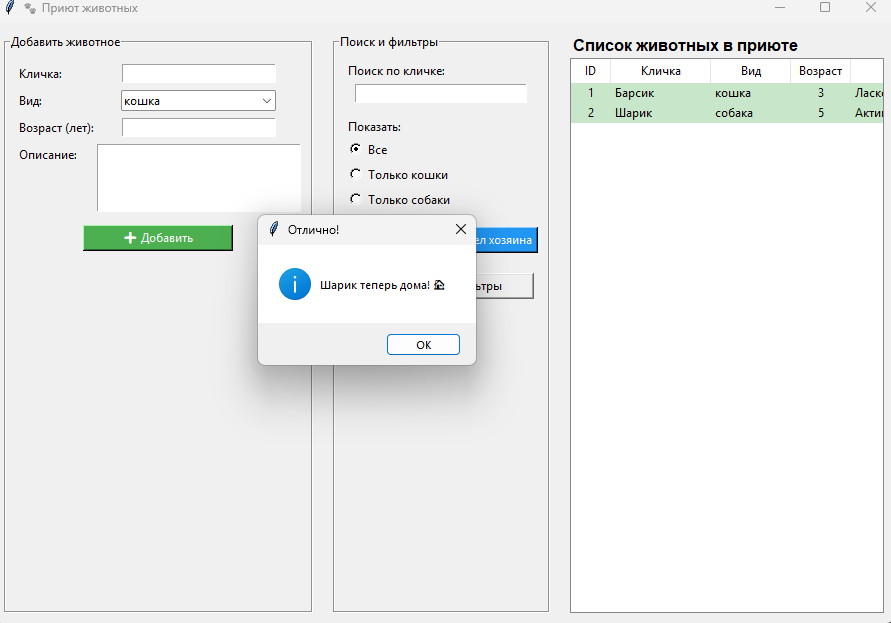

# [приют животным]

Представьте: вы работаете в компании «MySoft», которая разрабатывает небольшие приложения для бизнеса. К вам обратился заказчик My[python]. Он занимается [сфера деятельности], но сотрудники сталкиваются с проблемой: [что происходит и к чему приводит]. Вам поручили разработать [какое приложение], чтобы [ожидаемый результат].

**Автор:** [Белеков Нурэль Мирбекович 12ТЭС]. **Срок:** 3 спринта по 2 недели (всего 6 недель). **Статус:** проектирование; приложение  реализовано.

## Как начать свой проект

1. На странице этого репозитория нажмите **Use this template → Create a new repository** и создайте свой репозиторий. При работе через GitHub Classroom используйте адрес, выданный преподавателем.
2. Склонируйте **свой** репозиторий на компьютер и откройте его папку.
3. Прочитайте [задание](Задание.md), выберите тему и заполните README и документы в `docs/`.
4. Пишите код в `src/`, проверки — в `tests/`; сохраняйте изменения в своём репозитории.

Можно склонировать и сам шаблон:

```bash
git clone https://github.com/PKO-LP/student-project-template.git my-project
cd my-project
```

В этом случае сначала создайте свой пустой репозиторий на GitHub и замените адрес отправки (USERNAME и REPOSITORY замените своими значениями):

```bash
git remote set-url origin https://github.com/USERNAME/REPOSITORY.git
git push -u origin main
```

## Заказчик и проблема

My[python] —Mypython просит чтобы интерфейс приложения можно было добавить питомца

## Планируемая функциональность

Адаптируйте пункты к своей теме и согласуйте 5–6 простых функций:

- Добавление [теперь можно добавить питомца]
- Изменение данных с проверкой обязательных полей.
- Поиск и фильтрация по кличке питомца
- Изменение статуса по правилам 
- Удаление выбранной записи с подтверждением.

## Структура проекта

```text
project/
├── src/                 # Будущий исходный код
├── docs/                # Семь шаблонов документации
├── tests/               # Сценарии ручных проверок
├── README.md
├── .gitignore
└── requirements.txt
```

## Установка и запуск

Это стартовый шаблон. Команды запуска приложения станут доступны после создания `src/main.py`.

1. Скачайте репозиторий и откройте его папку в терминале.
2. Установите Python 3.11 или новее с поддержкой Tkinter.
3. Создайте `src/main.py` — главный файл программы. Для базового проекта внешние библиотеки не нужны.
4. После реализации приложения выполните:

```bash
python src/main.py
```

[Проверьте запуск по этой инструкции. Укажите, какие примеры записей можно ввести для демонстрации.]

## Технологический стек

Python + Tkinter — окна, поля, кнопки и список записей. Данные хранятся в списке словарей Python, пока программа открыта. Git и GitHub — 

База данных и SQL не требуются. При закрытии программы записи сбрасываются — для первой версии это допустимо. Сохранение в JSON-файл можно добавить позже по желанию. Tkinter обычно поставляется с Python; в некоторых установках его нужно установить отдельно.

## Спринты разработки

Спринт — короткий период работы с понятной целью. В конце каждого спринта покажите работающую версию, проверьте её и обсудите, что улучшить. Всего — 3 учебных спринта по 2 недели.

1. **Спринт 1 — первая рабочая версия.** Выбрать тему, заполнить устав, основные требования и ТЗ, нарисовать окно. Создать окно Tkinter с вводом и добавлением записей в список. **Результат:** можно добавить запись и увидеть её на экране.
2. **Спринт 2 — основные сценарии.** Добавить поиск, редактирование и изменение статуса. Уточнить требования и ТЗ, проверить новые функции. **Результат:** можно найти запись, изменить её данные и статус.
3. **Спринт 3 — готовый продукт.** Добавить удаление с подтверждением, исправить ошибки, завершить инструкцию и README. Проверить запуск на другом компьютере. **Результат:** все согласованные функции работают; проведена демонстрация и опубликован выпуск v1.0.

В начале спринта выберите задачи из общего списка Issues и перенесите их на доску. В конце — покажите результат преподавателю, заполните отчёт о статусе и кратко запишите: что получилось, что мешало, что измените в следующем спринте. Документацию обновляйте вместе с программой.

## Документация

- [Устав](docs/01_Устав_проекта.md).
- [План](docs/02_План_проекта.md).
- [Требования](docs/03_Требования.md).
- [Техническое задание](docs/04_Техническое_задание.md).
- [Протоколы встреч](docs/05_Протокол_встречи.md).
- [Отчёты о статусе](docs/06_Отчёт_о_статусе.md).
- [Документация продукта](docs/07_Документация_продукта.md).
