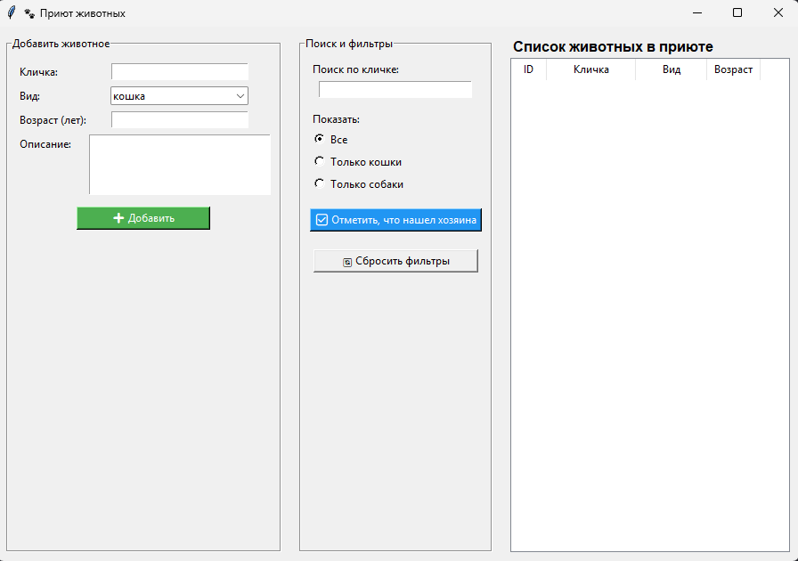

# План проекта

**Проект:** [проект животным]. **Заказчик:** My[python]. **Автор:** [ФИО, группа].
**Версия документа:** [1.1]. **Дата:** [19.11].

## План спринтов

Всего 3 спринта по 2 недели. Для каждого укажите даты, ответственного, оценку и фактические часы.

1. **Спринт 1.(19.11 - 02.12 12часов) Цель — добавить и увидеть запись.** Выбрать тему, подготовить устав, начальные требования и ТЗ, эскиз окна и поля записи. Реализовать ввод, проверку обязательных полей и добавление в список Python. Проверить эти действия вручную. Контрольная точка — демонстрация первой рабочей версии.(02.12)
2. **Спринт 2.(03.12 - 15.12 12часов) Цель — находить и изменять записи.** Реализовать поиск, редактирование и статусы; уточнить требования и ТЗ, проверить новые сценарии и исправить ошибки. Зависит от работающего списка из спринта 1. Контрольная точка — демонстрация основных сценариев.(15.12)
3. **Спринт 3.(17.12 - 31.12 12 часов) Цель — передать готовый продукт.** Реализовать удаление с подтверждением, проверить все согласованные функции и запуск на другом компьютере. Завершить руководство и README, провести приёмку и выпустить v1.0. Зависит от функций спринтов 1 и 2. Контрольная точка — итоговая демонстрация.(31.12)

## Задачи спринта № [1]

- Цель: [узнавать ].
- Даты: [19.11 - 20.11].
- Задачи: [Issue → ответственный → оценка в часах → зависимость → ожидаемый результат].
- Готово, когда: функция работает, ручная проверка пройдена, изменение сохранено в Git, документация обновлена.
- Итоги: [не нажималась ; что не завершили и почему; какие задачи перенесли в общий список].
- Что улучшить: [приложение приют для животных → мешали ошибки].

## Декомпозиция и зависимости

- Пример WBS: «Работа с заявками» → «Форма ввода» → «Проверка полей» → «Добавление в список Python».
- [Разбейте каждую крупную задачу на задачи до 2–4 часов. Укажите номера Issues и зависимости.]
- [Приложите диаграмму Ганта или сетевой график; отметьте критическую цепочку задач по длительности и зависимостям.]

## Контроль и изменения

- Контрольные точки: конец каждого из трёх спринтов; [19.11, Белеков Нурэль].
- Доска GitHub Projects: «К выполнению» → «В работе» → «На проверке» → «Готово». Ссылка: [].
- Проверка прогресса: короткая сверка в середине спринта и демонстрация в конце; [19.11]. Источник — выполненные задачи и демонстрация.
