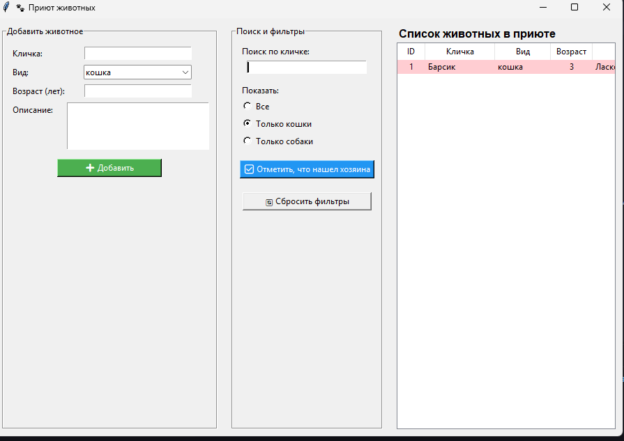

# Техническое задание

**Проект:** [приют животным]. **Заказчик:** My[python]. **Автор:** [Белелков Нурэль Мирбекович 12ТЭС].
**Версия документа:** [1.1]. **Дата:** [19.11].

## Назначение и функции

Система предназначена для [пользователи и процесс]. Основание — [[text](03_Требования.md)].
Обязательные функции: [номер 1.1 описание ; не переписывайте требования с другим смыслом].

## Интерфейс

- Интерфейс: одно главное окно Tkinter с полями ввода, кнопками и списком добавить, нашел хозяенна.
- Действия: [кнопки, поиск, фильтры, подтверждение удаления, если предусмотрено].
- Ошибки: [при попытке сбосить или добавить питомца сами кнокпи не нажимались].
- Макеты: [[text](../README.md)].

## Данные и реализация

- Стек: Python + Tkinter; внешние библиотеки не нужны.
- Запись: [панель добавить животное в ней находится кнопка добавить также в панели есть разделы: кличка, вид, возраст(лет), описание. Еще есть раздел поиск и филтры, список животных в приюте.].
- Пример: заявка — целочисленный уникальный номер, дата, описание техники, неисправность, статус.
- Хранение: список словарей Python в памяти. При запуске список пуст, после закрытия записи сбрасываются. Сохранение в файл — только как дополнительная функция по согласованию.
- Правила: [допустимые статусы, даты, уникальность и другие проверки].

## Приёмка

Для каждого обязательного FR заведите проверку: «номер → действия → ожидаемый результат → фактический результат → пройдено/не пройдено».

- AT-1 / FR-1: При выборе животного нажать на кнопку "отметить что нашел хозыеннна появиться кличка питомца и надпись что он нашел дом.".
- AT-2 / NFR-2: оставить обязательное поле пустым → сообщение, запись не создана.
- AT-3 / FR-5: выбрать заявку, нажать «Удалить» и отменить → заявка остаётся; повторить и подтвердить → заявка удалена.
- AT-4: закрыть и открыть приложение → список пуст; это ожидаемое поведение первой версии.
- [.]
- Условия сдачи: обязательные проверки пройдены; инструкция проверена; [  AT-1 — AT-7 пройдены; запуск проверен по результат принят преподавателем дисциплины в репозитории GitHub.].
