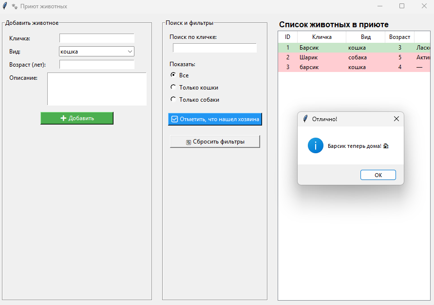

# Отчёт о статусе спринта

**Проект:** [приют животным]. **Заказчик:** My[python]. **Автор:** [Блеков Нурэль Мирбекович 12ТЭС].
**Версия документа:** [1.1]. **Дата:** [19.11].

Копируйте раздел отчёта в конце каждого спринта, сохраняя историю. При необходимости добавляйте промежуточный отчёт.

## Отчёт за спринт № [3]

- Цель спринта: УЗНАВАТЬ в программе вид животного возраст и т.д.
- Период: [19.11]. Дата отчёта: [19.11].
- Общий статус: по плану . 

- В работе: [задачи и ожидаемые даты завершения].
- Проблемы: [что уже произошло → влияние → действие → ответственный].
- Риски: 
- План следующего спринта (для последнего — дальнейшие улучшения): [2–4 результата и сроки].
- Готовность: [выполненный объём / общий объём × 100%].

Пример расчёта: задачи оценены суммарно в 40 часов; приняты задачи на 10 плановых часов → готовность 25%. Частично выполненные задачи не засчитываются; после изменения объёма обновите знаменатель.

- Демонстрация: [показали интерфейс по заданному приложению  → принято исправтить некторые ошибки].
- Выводы: [получилось приложение "приют животным" → ].
- Качество: [проведенно 2 проверки, пройденно 2 проверки, не получалось добавить питомца и сбросить фильтр].
- Нужное решение заказчика: [вопрос, варианты, крайний срок 20.11;].
