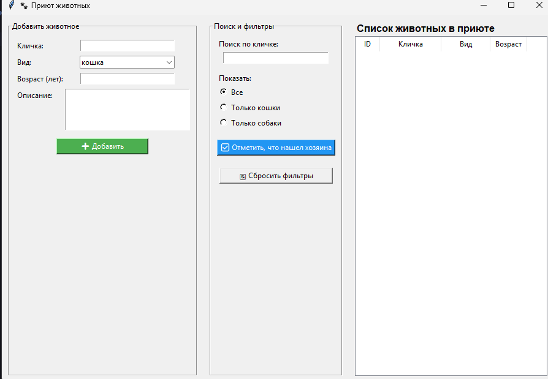

# Документация продукта

**Проект:** [приют животным]. **Заказчик:** My[python]. **Автор:** [Белеков Нурэль Мирбекович 12ТЭС].
**Версия документа:** [1.1]. **Дата:** [19.11].

 **Статус инструкции:** [Дата 19.11.2026 ].

## Назначение

[для тех кто хочет найти своего питомца по кличке и узнать его возраст]

## Установка и запуск

1. [версия 3.11].
2. [через github].
3. [Команда запуска: python src/main.py; внешние зависимости для базовой версии не нужны. Согласуйте с README].
4. [примеры демонстрации нужно своего питомца по кличке или выбрать нового и при этом узнать его возраст и описание].

## Основные сценарии

- [для того чтобы найти животное нужно найти раздел "поиск по кличке" и ввести его кличку для того чтобы добавить надо написать его кличку, выбрать вид кот/собака, ввести его возраст при желании описание его и нажать кнопку добавить.].
- Найти [объект]: [где искать → что ввести → как открыть результат].
- Изменить данные или статус: [действия и допустимые значения].
- Завершить работу: [нажать на крестик; сбрасывается возраст и сами животные].
- [то как выгледит мой интерфейс]

## Частые вопросы

- Запись не добавляется. [обязательные поля в том что нужно добавить возраст и ключку питомца]
- Ничего не найдено. [чтобы сбросить или добавить фильтр нужно нажать на кнопку]

## Проверка и завершение проекта

- Проверки: [19.11, ошибки были в том что иногда не получалось сбросить или добавить животного после нахождения ошибки были удаленны].
- Результат приёмки: [20.11, решение, [text](../tests/main.py)]
- Итоги: [получилась рабочее приложение по теме "приют дивотным"].
